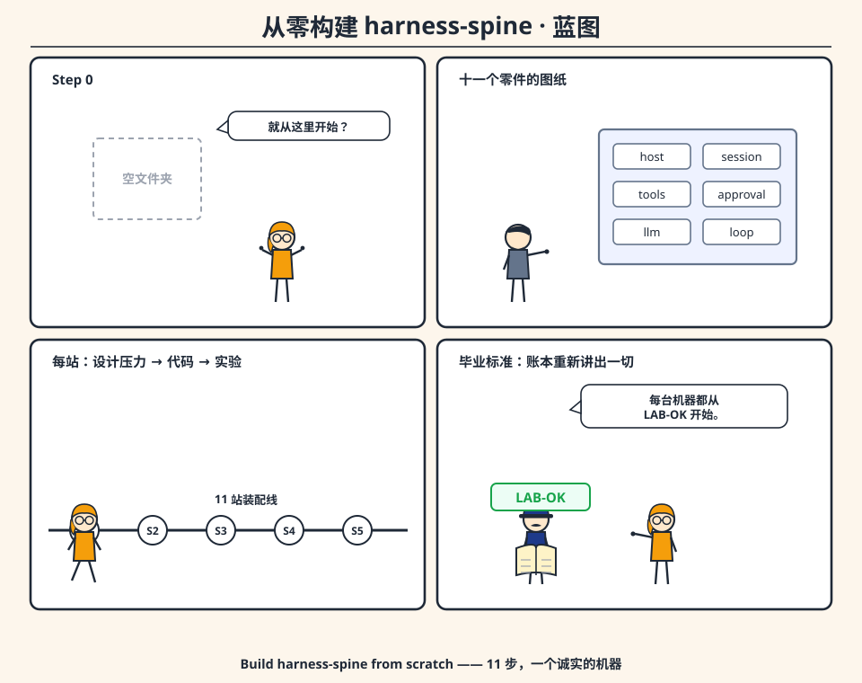
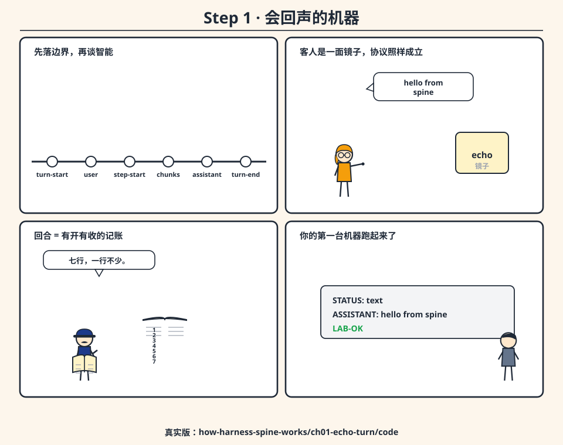
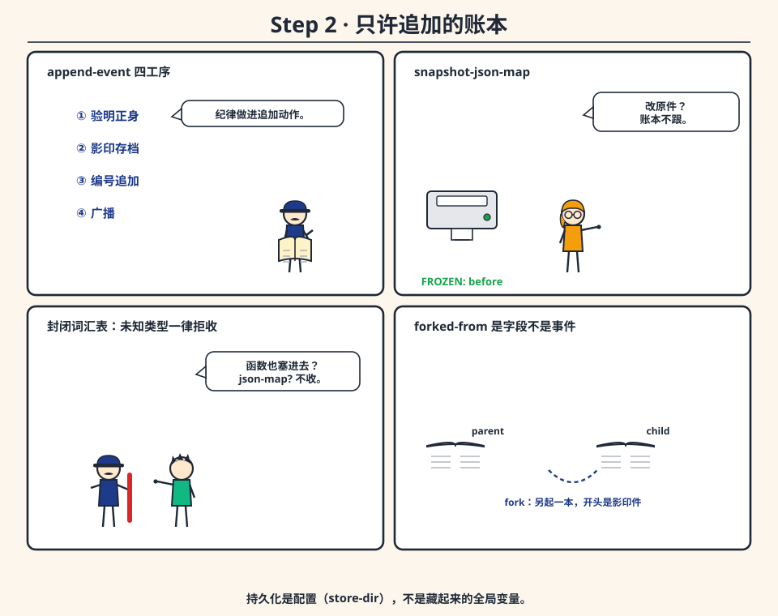
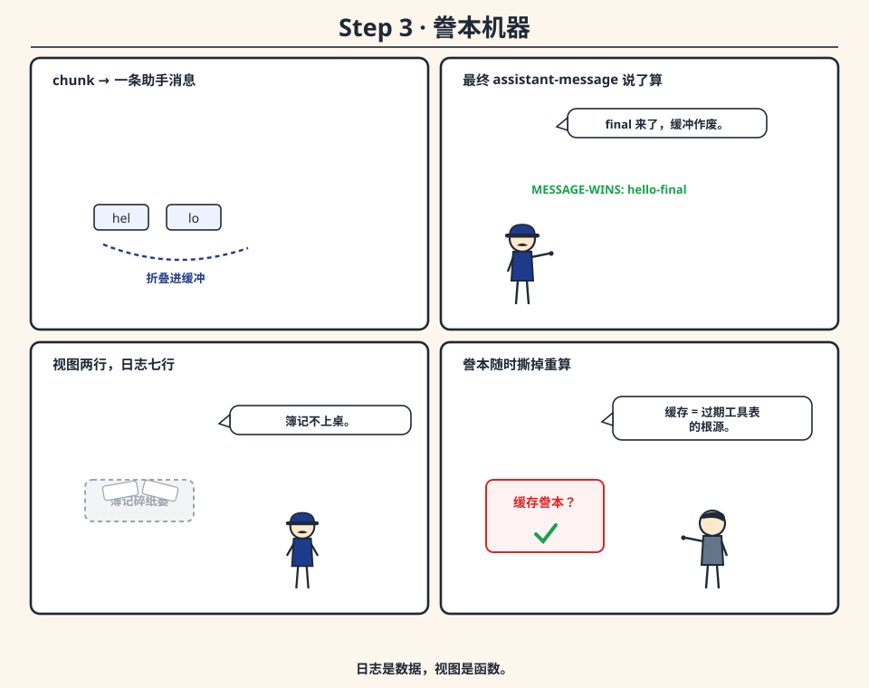
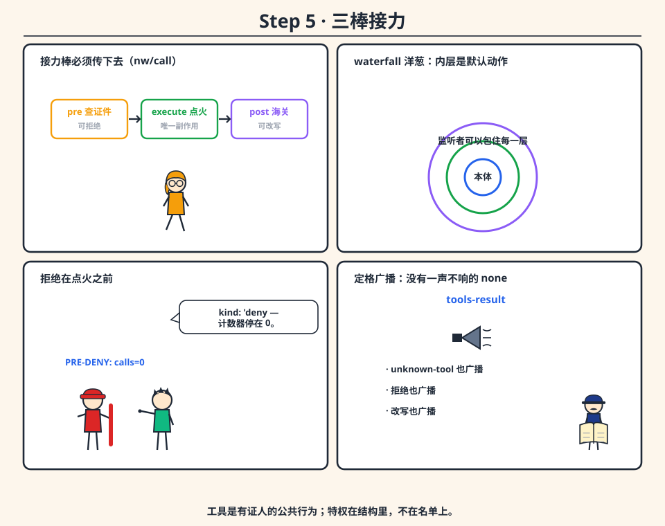
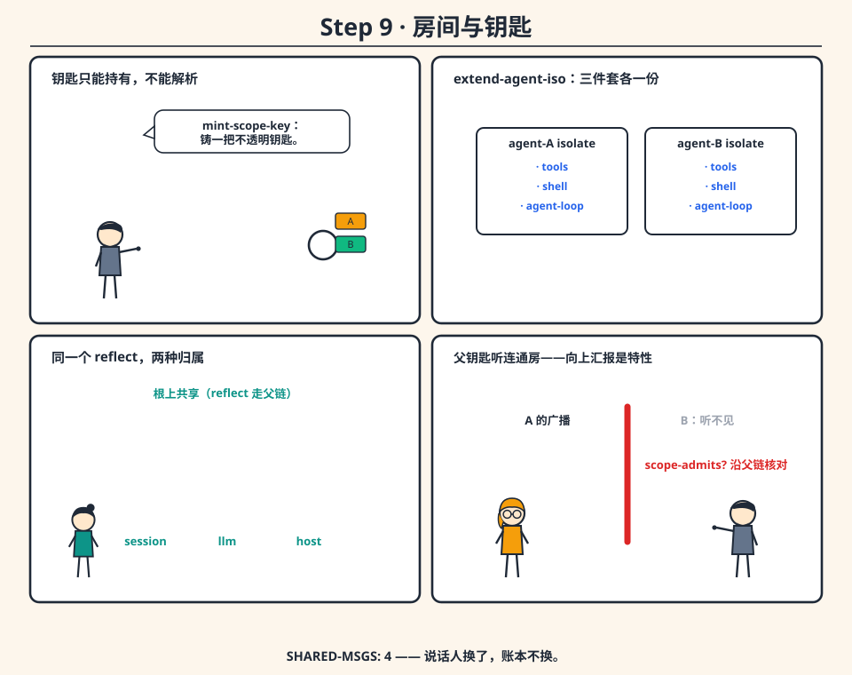
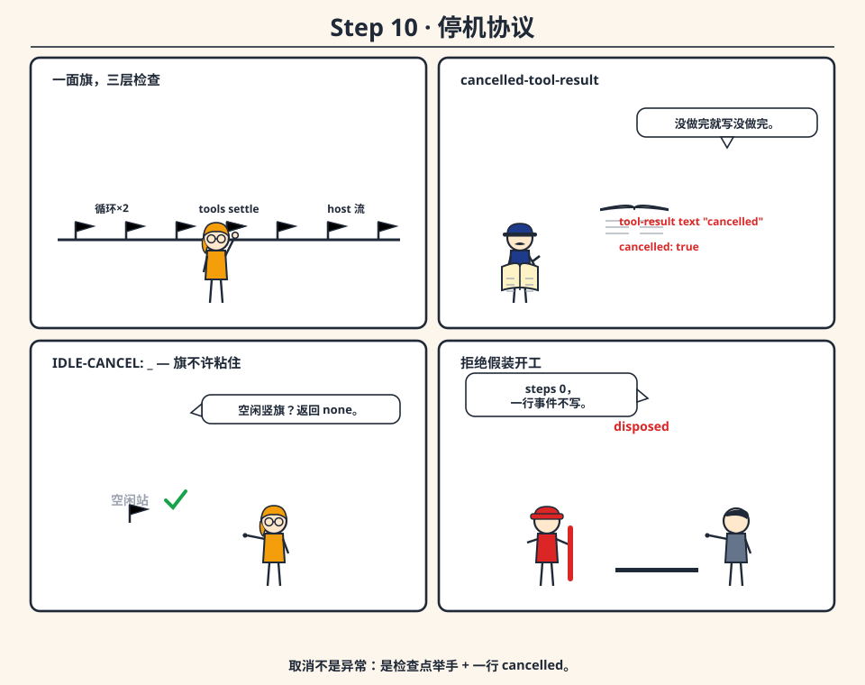
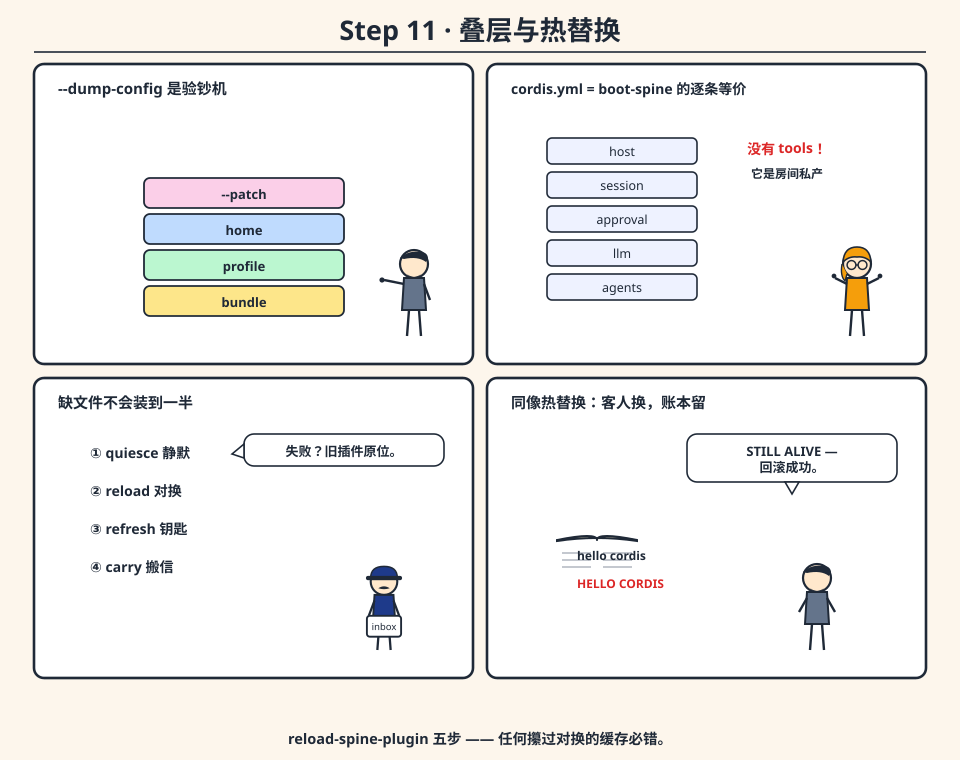

# 从零构建 harness-spine

**Build harness-spine from scratch——11 步搭起一台能说话、能动手、能记住、能被叫停的机器**



> 这是一本动手书。每一章都遵守同一格式：**设计压力**（朴素做法怎么死的）→ **关键代码**（真实节选或教学简化版，注明出处文件）→ **跑实验**（真实仓库的教学切片）→ **检查点**（你该看到什么）。
>
> 配套阅读：[Head First harness-spine](../head-first-harness-spine/HEAD_FIRST_HARNESS_SPINE.md)（漫画概念版）、[harness-spine 是怎样工作的](../../how-harness-spine-works/HOW_HARNESS_SPINE_WORKS.md)（源码逐章版）。

## 路线图

```text
Step 00 装备检查          —— r3、仓库、第一个 LAB-OK
Step 01 会回声的回合      —— turn-start … turn-end 的最小闭环
Step 02 只许追加的账本    —— session：验证 / 快照 / 编号 / 广播
Step 03 誊本              —— derive-messages：chunk 折叠，最终消息说了算
Step 04 一扇门            —— host：run-command / http / delay
Step 05 有证人的工具      —— tools：pre / execute / post 三条 waterfall
Step 06 只问一次          —— approval：asked/decided 双入账，缺席即拒绝
Step 07 请一位客人        —— llm：queue → script → http → echo
Step 08 回合引擎          —— run-turn-core 全流程 + inbox / resume
Step 09 房间与钥匙        —— isolate + scope：私人动手，共享前台
Step 10 停机的协议        —— cancel：检查点 + cancelled 行
Step 11 装配与热替换      —— boot / yaml / profile / reload
```

为什么用 Rebol？因为它小到**能读完**：`map!` 是 `#[key: value]`，`block!` 是 `[a b c]`，word 是 `'name`，函数是一等公民。你将看到，一台诚实的机器并不需要一百个抽象。

---

# Step 0 装备检查

**目标**：跑通第一个教学实验，确认你手里的 `r3` 活着。

```bash
cd ../../how-harness-spine-works/ch01-echo-turn/code
bash run.sh          # run.sh 会把工作目录设到 harness-spine 根，
                     # 因为 boot.reb 靠相对路径加载 ../cordis-port
./verify-all.sh      # 回到 how-harness-spine-works/ 目录跑，expect: 10/10 OK
```

**检查点**：`ASSISTANT: hello from spine`、事件类型表、`LAB-OK`。`PATH` 上没有 `r3` 时 `verify-all.sh` 会安静地跳过——这不是失败，是诚实。

**地图**：真实源码树里每个零件一个目录——`host/ session/ tools/ shell/ approval/ llm/ agent-loop/ scope/ agent/`，外加 `boot.reb`（代码装配）、`boot-yaml.reb`（YAML 装配）、`profile.reb`（叠层）。本书每一步都告诉你「真实版在哪个文件」，简化片段只为看清骨架。

---

# Step 1 一台只会回声的机器



**目标**：不引任何插件，手写一个最小回合——把「回合」从玄学变成**记账协议**。

## 设计压力

朴素做法是写个函数：`reply: llm messages; print reply`。它能跑，但回答不了两个问题：**这回合从哪行开始、到哪行结束？** 没有边界，就没有审计。所以第一步不是调模型，而是**落两行簿记**。

## 关键代码（教学简化版；真实版 `agent-loop/api.reb` 的 `run-turn-core`）

```rebol
REBOL []

log: make block! 32

append-event: func [type [word!] payload [map!]] [
    append log make map! compose [
        type: (type)
        payload: (payload)
        index: (length? log)
    ]
]

echo-reply: func [user-text [string!]] [
    make map! compose [kind: 'text text: (user-text)]   ; echo 适配器
]

run-turn: func [user-text [string!]] [
    append-event 'turn-start make map! []               ; ① 开幕
    append-event 'user-message make map! compose [text: (user-text)]  ; ② 入账
    append-event 'step-start make map! [n: 1]           ; ③ 步起
    reply: echo-reply user-text                          ; ④ 问客人
    append-event 'assistant-chunk make map! compose [text: (reply/text)]
    append-event 'assistant-message make map! compose [text: (reply/text)] ; ⑤ 合体
    append-event 'step-end make map! [n: 1]
    append-event 'turn-end make map! compose [          ; ⑥ 收工
        status: 'text steps: 1 text: (reply/text)
    ]
]
```

跑起来，`log` 里正好七行事件，与真实仓库第 01 章实验打印的表完全同构。

## 跑实验

```bash
cd ../../how-harness-spine-works/ch01-echo-turn/code && bash run.sh
```

## 检查点

- `STEPS: 1`、`ASSISTANT: hello from spine`；
- 事件类型 `[turn-start user-message step-start assistant-chunk assistant-message step-end turn-end]`；
- `LAB-OK`。

## 试一试

在真实仓库里把用户串改成 `"ping"`（echo 会照抄），再 `enqueue` 一条 `"not-an-echo"` 看队列插队——你刚刚体验了 Step 7 的适配器次序。

**收获**：回合 = 一段有开有收的记账。模型是谁，暂时无关紧要。

---

# Step 2 一本只许追加的账本



**目标**：把 Step 1 的裸 block 升级成带纪律的 session 服务：**验证、快照、编号、广播、可选落盘。**

## 设计压力

裸 block 有四个漏洞：什么类型都能塞；塞进去的 map 是**活的**（调用方回头一改，历史跟着变）；行号靠猜；没人知道发生了什么。朴素修补是「塞之前小心点」——纪律靠自觉，等于没有纪律。正确的做法是把纪律**做进追加动作本身**。

## 关键代码（真实版 `session/api.reb`：`append-event`；快照在 `session/json.reb`：`snapshot-json-map`）

真实实现每次追加做四件事，顺序固定：

```rebol
; —— 教学简化版 ——
append-event: func [id [string!] ev-type [word!] payload] [
    validate-payload ev-type payload                 ; ① 验明正身
    payload: snapshot-json-map payload               ; ② 影印存档（深拷贝）
    record: make map! compose [
        type: (ev-type) payload: (payload) index: (length? events)
    ]                                                ; ③ 连续编号追加
    append events record
    events/emit 'session-event reduce [session record]  ; ④ 广播
]
```

词汇表是**封闭**的：`turn-start`（空载荷）、`user-message` / `assistant-message` / `assistant-chunk`（`#[text]`）、`tool-call`（`#[name args call-id]`）、`tool-result`（`#[name call-id text]`）、`step-start` / `step-end`（`#[n]`）、`turn-end`（`#[status steps text]`）、审批三件套……`validate-payload` 拒绝一切名单之外的类型，函数和循环引用对象连门都进不来（`json-map?` 不收）。

fork 就一条规则：把前缀拷进新 id，session 对象上记一个 `forked-from` 字段。**它是字段，不是事件**——它描述的是这本账的出身，不是账里发生过的事。

## 跑实验

```bash
cd ../../how-harness-spine-works/ch03-session-log/code && bash run.sh
```

## 检查点

- `FROZEN: before`——你当面改了 map，账本没跟（快照生效）；
- `PARENT-MSGS: 2 / CHILD-MSGS: 3`、`FORKED-FROM: s3`（分叉各写各的）；
- `REOPENED: persist me | ok`——设了 `store-dir` 后，重启 `open` 完整复原（落盘文件是 `<id>.events.reb`，内容 `mold/all events`）。

## 试一试

1. 追加 `"before"` 后去改**嵌套** map，确认快照是递归的。
2. 不设 `store-dir` 直接 `open`——应当得到一个明确的错误：`open requires store-dir backend`。**持久化是配置，不是隐藏的全局变量。**

**收获**：历史的诚实是结构给的，不是自觉给的。

---

# Step 3 誊本：derive-messages



**目标**：写出一个**纯函数**：账本进，聊天出。无状态、可重跑、可扔。

## 设计压力

视图最先诱惑你**缓存**：「算一次存着多快」。可缓存正是第 07 章实验里「取消或 fork 之后工具表悄悄过期」的病根。誊本必须随时可以撕掉重写——这是它区别于第二份历史的关键。

## 关键代码（真实版 `session/api.reb`：`derive-messages`）

```rebol
; —— 规则骨架 ——
; user-message / assistant-message → #[role: 'user|'assistant content: text]
; 连续 assistant-chunk             → 折进缓冲
; 后面跟着 assistant-message       → 缓冲作废，最终那条说了算
; 没有最终消息                     → 缓冲兜底誊出（半截也是事实）
; tool-call                        → #[role: 'assistant kind: 'tool-call name: … args: … call-id: …]
; tool-result                      → #[role: 'tool name: … content: …]
; 回合簿记（turn-start/step-end/审批…）→ 一概不上桌
```

第 01 章的 echo 回合：账本七行，誊本两行。差额 = 簿记 + chunk 折叠——每一行差额都有名字，没有一行是「丢了」。

## 跑实验

`ch03` 实验里的 `FOLDED: hello` / `MESSAGE-WINS: hello-final` 就是这两条规则的现场执法。

## 检查点

你能口头回答：两条 chunk（`"hel" "lo"`）+ 一条 `assistant-message`（`"hello-final"`）之后，誊本里有几行助手消息？——一行，`"hello-final"`。

## 试一试

给 `derive-messages` 喂一条**末尾停在 user** 的账本，观察它照样返回誊本——但下一步的循环（Step 8）会拒绝开工。**誊本无条件服务；开工要看契约。**

**收获**：日志是数据，视图是函数。把两者焊死的设计（数组即记忆）死于第一次流式重试。

# Step 4 一扇门：host

**目标**：把「摸真实世界」收敛到唯一一个服务：`host`。shell、HTTP、流式 HTTP、delay，全走它。

## 设计压力

朴素做法：bash 工具自己 `call/wait/shell`，HTTP 适配器自己拉 `curl`，等待就 `sleep`。单看每条都顺，合起来三个死局：**取消**杀不掉一个不是自己启动的子进程；**测试**必须先搭真网络；**清理**时两个插件各自拉的进程互相打架。病根一句话：副作用四处开花，无人问责。

## 关键代码（真实版 `host/api.reb`：`make-host-service`）

```rebol
; —— 真实行为摘录 ——
run-command command           → #[ok code stdout stderr]   ; 永远是 map，退出码非零也不抛
http-get    source            → #[ok body]                 ; url! 或 file!（文件 = 免网络重放）
http-post  url body           → #[ok code body stderr]     ; body 先落临时文件再 shell curl
http-post-stream/on-line/cancel source body sink cancel-obj
                              → #[ok cancelled body error?] ; url! 源后台 curl -N，取消 = 杀 pid
delay ms value               → thenable（挂确定性调度器）
settle value                 → 泵调度器直到 thenable 决议
```

三条设计决定值得背下来：

1. **报告，不抛**。`run-command` 返回的永远是一张带 `ok` 的 map——tools 和测试消费结果，而不是接语言错误。「ls 失败了」是世界的一部分，不是程序故障。
2. **`file!` 源是一等公民**。`http-get`/`http-post-stream` 接受文件，是为了让 `llm/http.reb` 等上层**不碰 socket 就能重放**——夹具测试从此免费。
3. **delay/settle 也是 I/O**。异步等待走同一条门（挂到运行时 scope 的调度器上），循环才能一边泵调度器一边看得见取消旗——Step 10 的地基在这里。

## 跑实验

```bash
cd ../../how-harness-spine-works/ch02-host-door/code && bash run.sh
```

## 检查点

`CMD-OK: #(true)` / `GET-BODY: host-file-body` / `DELAY-SETTLED: 99`。「试一试」把 `run-command` 改成 `"false"`：`ok` 变 `#(false)`、`code` 非零、**没有异常**——host 报告，不抛错。

## 试一试

把 `h/settle d` 换成直接打印 `d`——你会看到一个 thenable 对象而不是 `99`。这就是循环和 tools 都要调 `settle` 的原因：**等待是一门服务，不是一个值。**

**收获**：世界只有一个入口。审计、替身、取消，全站在同一扇门后。

---

# Step 5 有证人的工具：tools waterfall



**目标**：把工具执行从「函数表查名字」升级成「三条 waterfall + 一次定格广播」。

## 设计压力

函数表的三个死局：策略想在函数**存在之前**说不——没有时机；沙箱想在函数**跑完之后**改写 stdout——没有槽位；观察者想围观——没有事件。于是每个特例都长成 `if name = 'bash [check ...]`，最后长成第二套解释器。

## 关键代码（真实版 `tools/api.reb`：`execute`）

```rebol
; —— execute 的真实骨架 ——
exec: make map! compose [name: (tool-name) args: (args)]

out: ctx/events/waterfall 'tools-pre-execute reduce [exec]
    func [exec] [make map! [kind: 'allow]]           ; 默认内层：放行

out: ctx/events/waterfall 'tools-execute reduce [exec]
    func [exec] [spec/run/call exec/args]            ; 默认内层：唯一点火

out: ctx/events/waterfall 'tools-post-execute reduce [exec out]
    func [exec out] [out/2]                          ; 默认内层：原样递出

result: coerce-result out                             ; 非 map → #[ok true name text]
emit-result exec result                              ; 追加 result-log 并广播 'tools-result
```

规则浓缩成四句：

- **pre 是拒绝闸**：返回 `kind: 'deny`（或 `ok: false`）→ 造一份合成错误、广播、返回——`spec/run/call` 碰都不碰；
- **execute 是唯一点火点**：副作用只许发生在这层内层里（或本体转手调 host）；
- **post 是改写窗**：实验里 stdout 变 `"rewritten"` 但工具真跑了一次——涂黑合法，偷跑非法；
- **广播定格**：`tools-result` 载荷是 `reduce [exec result]`，观察者看到的是做完的 map。未知工具照样广播：`#[ok false error "unknown-tool"]`——**没有一声不响的 none**。

`shell-plugin` 是存在证明：它注入 `tools` 和 `host`，登记 `'bash` 规格（`call` 就是 `host/run-command`）。循环调的是 `tools/execute/meta`，从不知道 bash 存在。

## 跑实验

```bash
cd ../../how-harness-spine-works/ch04-tools-waterfall/code && bash run.sh
```

## 检查点

`PRE-DENY: pre-denied calls=0`、`POST-REWRITE: rewritten calls=1`、`BASH-STDOUT: through-host`、`UNKNOWN-ERR: unknown-tool`。

## 试一试

亲手复现 exec-stage deny：前置一个 `tools-execute` 监听者返回 `make map! [ok: false error: "exec-denied"]` 且**不调内层**——`ping-calls` 应停在 0。

**收获**：工具是公共行为，证人在场。多出的「四个名字」，买的是每个特例都有正门可走。

---

# Step 6 只问一次：approval

**目标**：给危险动作装一道一次性审批缝：**问与答都入账，缺席即拒绝，没有通行证仓库。**

## 设计压力

朴素方案三连败：布尔开关会在这段代码里默认 true、在另一个代码库里默认 false；提问中途进程死掉，「人到底答没答」永远成谜；「用户同意过一次」变成粘住不放的通行证。三者同源——**审批没有账本**。

## 关键代码（真实版 `approval/api.reb`：`request` / `decide-outcome`）

```rebol
; —— request 的真实纪律 ——
; 前置条件：必须存在打开的回合（有 turn-start 无 turn-end），否则抛错
; ① 造 id "a<随机>"
; ② 账本记 approval-asked   #[id tool-name call-id reason?]
; ③ policy 为 'never 时：不问人，直接 'rejected
; ④ 否则送 'approval-request waterfall，默认内层返回 'unavailable
; ⑤ normalize：四个合法值 [allowed-once rejected cancelled unavailable] 之外的
;    一律塌缩为 'unavailable（界面钩子上的拼写错误不许变成通行证）
; ⑥ 账本记 approval-decided #[id outcome]
```

策略也入账：`set-policy` 记 `approval-policy #[policy: 'ask|'never]`，`effective-approval-policy` 倒扫最近一行。于是同一个 session 可以**先宽松后收紧**，回放时看得见转变时刻。

产品侧的入口在 `tools/execute`：pre 返回 `kind: 'ask`（或规格标了 `approval: 'ask`）→ `resolve-approval-ask` 要求 meta 里带 `session-id` → 调 `approval/request` → **只有 `'allowed-once` 才能继续走进执行内层**。本体从头到尾看不见拒绝那条路。

## 跑实验

```bash
cd ../../how-harness-spine-works/ch05-approval-once/code && bash run.sh
```

## 检查点

`NEVER: rejected`（策略免问）、`NO-ANSWERER: unavailable`（缺席即拒绝）、`OUTSIDE-TURN: #(true)`（回合外请求被拒）、`TOOL-DENIED: #(false)` / `TOOL-GRANTED: allowed-body`。

## 试一试

给回答者喂字符串 `"allowed-once"`——`normalize` 接受这个转换；喂 `"sure"`——塌缩为 `unavailable`。再喂一个 `word!` 拼错的 `'allowd_once`，亲眼看着它进不了通行名单。

**收获**：审批的诚实 = 两次入账 + 一个塌缩规则。UI 是你的事，账本是脊柱的事。

---

# Step 7 请一位客人：llm 适配器

**目标**：实现 `llm` 服务与它的四级适配器：queue → script → http → echo，并让流式输出落进 sink 而不是账本。

## 设计压力

「SDK 就是智能体」的代价：取消要跟 SDK 的 HTTP 客户端打架；测试要真网络；换供应商等于换循环。病根是**所有权**——模型的服务和机器的控制搅在一个对象里。

## 关键代码（真实版 `llm/api.reb` + `llm/script.reb` + `llm/http.reb`）

```rebol
; —— resolve-reply 的敲门次序 ——
; ① queue 非空   → take queue          （脚本化适配器，测试用，永远最优先）
; ② 配了 script  → run-llm-script      （把请求 mold 进临时文件，r3 -q 跑，解析 stdout）
; ③ 配了 http-url→ run-llm-http        （经 host post；流式走行协议）
; ④ 兜底         → echo last-user-content（没有厂商也走得完一个回合）

; —— 回复只有两种形状 ——
; #[kind: 'text      text: <string!>]
; #[kind: 'tool-call name: <word!> args: <map!>]

; —— 流式：sink 收 chunk，账本归循环 ——
; run-llm-http-stream：行协议 #[delta "..."]，非空纯文本行也算增量；
; 可选的最终 #[kind 'text text]；流中途取消 → reply/cancelled: true
```

客人不许做的事：**另挑一个 session**、**自己调 `tools/execute`**。`tool-call` 回复是数据，不是判决——名字存不存在、要不要审批、取消提没提，循环说了算。

## 跑实验

```bash
cd ../../how-harness-spine-works/ch06-llm-guest/code && bash run.sh
```

## 检查点

`ECHO: hello guest`、`ENQUEUED: from-queue`、`TURN-TYPES` 里两条 `assistant-chunk`、`DERIVE-MATCH: #(true)`（流式与非流式的誊本完全一致）。

## 试一试

最诚实的坏数据测试：`chunks: ["hel" "lo"]` 而 `text: "mismatch"`。sink 照走 chunks，最终消息照取 text，**两份都如实入账**——适配器的诚实要紧，但机器不为它兜谎。

**收获**：适配器是客人的嘴。多嘴不行，代笔更不行。

---

# Step 8 回合引擎：run-turn-core

**目标**：把前面所有零件装进一个循环——每一步重读账本，支持 inbox、resume 与六种收场。

## 设计压力

「可变对话对象 + while」作为控制流会再死一次：取消留下没结果的 tool-call；resume 分不清该不该补一行用户记录；插件想改输入就得改界面正打印的数组。结论同第 03 章：**循环不持有对话，循环每步重读账本。**

## 关键代码（真实版 `agent-loop/api.reb`：`run-turn-core`，`max-steps` 默认 8）

```text
run-turn-core session-id user-text:
  0. agent-active? 不活 → #[status 'disposed steps 0 text ""]，不写任何事件
  1. live-session-id: session-id; cancel-requested: false
  2. turn-start {}
  3. 领取 next-turn inbox → 每封信落一行 user-message
  4. 非 resume 且有 user-text → user-message
  5. 循环每步：
     cancel 检查 → 'cancelled
     step >= max-steps → 'max-steps
     step-start #[n]
     claim next-step inbox → user-message 行
     proposed: sessions/derive-messages          ; ← 重读账本
     'agent-pre-step：交回 block 改写；交回 #[kind 'reject] → step-rejected + 'rejected
     'agent-request：可整体换供应商/工具表
     reply: llm/stream/on-chunk/cancel（sink 把 chunk 落成 assistant-chunk）
     kind 'tool-call → 记 tool-call（call-id "c<step>"）→ 取消检查 →
        tools/execute/meta + settle → 记 tool-result → step-end → 下一圈
     kind 'text      → 记 assistant-message → step-end → 'text 收工
  6. finish-turn：turn-end #[status steps text]，清旗
```

**resume 契约**：`resume-turn` 不写新用户行。放行条件只有两种——`can-admit-turn?` 判定誊本以 `tool`/`assistant` 收尾；或 inbox 领到了会叫醒循环的 `followup`/`steer`。誊本末尾停在 `user` 的日志会被判 `no-input`（`test/session-fork-test.reb` 锁住了这条边）。

## 跑实验

```bash
cd ../../how-harness-spine-works/ch07-the-turn/code && bash run.sh
```

## 检查点

`TOOL-ROLES: [user assistant tool assistant]`（工具结果经誊本进入下一轮输入）、`RESUME-ROLES: [user assistant assistant]` 且 `RESUME-USER-ROWS: 1`（不捏造访客）、`PRESTEP-LOG-USER: hello from pre-step`（账本原文未被耳语污染）。

## 试一试

1. `enqueue` 九次 bash tool-call、不给文本——第 9 步应当以 `max-steps` 收场。
2. pre-step 监听者返回 `#[kind 'reject reason: "nope"]`——出现 `step-rejected #[n reason]`，状态 `rejected`。

**收获**：到这里，Step 1 的玩具已经长成引擎——六种收场（`text` / `max-steps` / `rejected` / `cancelled` / `disposed` / `no-input`）每一种都有对应的账面事实。

# Step 9 房间与钥匙：isolate + scope



**目标**：让第二个智能体入场：tools/shell/agent-loop 每人一份，session/llm/host 全员共用，事件路由靠钥匙不靠翻载荷。

## 设计压力

根上放全局工具箱，第二个智能体一来就三连撞：登记表互踩、取消旗共用、广播互相偷听。在根上给每个方法加 `if agent-id = ...` 过滤？那是把 isolate 的逻辑摊进**每一个插件**——隔离不该是每个插件的心事。

## 关键代码（真实版 `scope/api.reb`：`create-agent-handle`；内核 `ctx/isolate` / `ctx/extend`）

```rebol
; —— create-agent-handle 的四步 ——
; ① key: mint-scope-key label                  ; 不透明对象钥匙（带 label，没法解析）
; ② /parent 时 bind-scope-parent key parent-key ; 认父（带环检测）
; ③ extend-agent-iso root label                 ; isolate-map 增加:
;      tools / shell / agent-loop  →  'agent-<label>
;    然后 root/extend 造出子 ctx——这三个插件在子 ctx 里各有自己的 registry
; ④ attach-scope-ctx agent-iso key              ; 钥匙挂进 ctx/extra/scope-key-ref
;    再 registry/plugin tools/shell/loop 到子 ctx
; 返回 handle 对象：id / scope-key / ctx / tools / driver / spine
;   + 委托方法 run-turn / resume-turn / followup / steer / inject / cancel-turn
```

**事件路由**：`tools-result` 广播时带 `make-scope-target scope-of ctx` 作载体；监听者侧 `scope-admits?` 从派发钥匙沿父链核对——没挂钥匙的监听者看得到一切，挂了钥匙的只听自己（和父链承认的）派发。所以：A 听不见 B，**孩子能向上汇报**（父钥匙挂在根上时）。

**handle 的查询走隔离**：`handle/tools` 和 `handle/driver` 是在子 ctx 里 `reflect/get` 出来的，不在根上查。同一个 `reflect/get 'sessions` 却从父链解析到前台——**同一个动词，两种归属，全看 isolate-map。**

## 跑实验

```bash
cd ../../how-harness-spine-works/ch08-isolate-rooms/code && bash run.sh
```

## 检查点

`WHO-A/WHO-B` 各回各的名、`B-HEARD-A: #(false)`、`PARENT-HEARD-CHILD: #(true)`、`SHARED-MSGS: 4`（同一 session，说话人换了账本不换）。

## 试一试

只给 A 登记 `whoami`，然后 `agent-b/tools/execute 'whoami`——`unknown-tool`。**隔离不是前缀过滤；规格根本不在 B 的房间里。**

**收获**：动手权按房间分配，记忆按前台共享——两件事从此独立配置。

---

# Step 10 停机的协议：cancel



**目标**：把「停下」从杀进程升级成协议：空闲不粘旗、检查点诚实、cancelled 行入账。

## 设计压力

`Ctrl-C` / `kill` / 回调抛异常的共同罪状：session 里留下**没有结果的 tool-call** 或半截流，下一次誊本把鬼魂当历史。第 08 步你已经在循环里埋好了检查点，本步把它们接上同一面旗。

## 关键代码（真实版 `agent-loop/api.reb`：`cancel-turn` / `turn-cancelled?` / `cancelled-tool-result`）

```rebol
; —— 旗的契约 ——
cancel-turn: does [
    all [string? live-session-id  cancel-requested: true  live-session-id]
    ; 空闲（live-session-id 是 none）→ 返回 none，不竖旗
]
turn-cancelled?: does [
    any [cancel-requested  not agent-active?]   ; 旗，或 Fiber 已死（dispose 也算）
]
; finish-turn / no-input 收场都会：live-session-id: none + cancel-requested: false

; —— 被取消的工具调用永远落这一行 ——
cancelled-tool-result: func [name call-id] [
    make map! compose [name: (name) call-id: (call-id)
                       text: "cancelled" cancelled: true]
]
```

三层检查共享同一个 cancel-check 对象（`call: does [turn-cancelled?]`）：

- **循环层**：步进开头、`step-start` 后、流结束后、execute 前后；
- **tools 层**：`settle/cancel` 每泵一次调度器就问一次；
- **host 层**：`http-post-stream` 在 cancel 对象触发时**杀掉 curl 的 pid**。

被 dispose 的智能体连开工都不肯：`run-turn` 在入口被 `turn-cancelled?` 拦下，返回 `#[status 'disposed steps 0 text ""]`，一行事件不写。

## 跑实验

```bash
cd ../../how-harness-spine-works/ch09-cancel-protocol/code && bash run.sh
```

## 检查点

`IDLE-CANCEL: _` / `IDLE-FLAG: #(false)`（空闲契约）、`CANCEL-STATUS: cancelled` + `FLAG-CLEARED: #(false)`、`HAS-TOOL-CALL/HAS-TOOL-RESULT: #(true)` 而 `HAS-ASSISTANT: #(false)`、`RESULT-TEXT: cancelled`、`DISPOSED: disposed`。

## 试一试

1. 把 abort 工具里的 `drv/cancel-turn` 删掉——状态变 `'text`、`HAS-ASSISTANT: #(true)` 且文本是 `"should-not-run"`：**取消的意义在对比里**。
2. 空闲连按两次 `cancel-turn`——两次 `_`。旗不许粘住，下一回合无辜的工作不陪葬。

**收获**：诚实下限 = 不记没发生的成功；已知上限 = 已提交的外部副作用没有两阶段中止——这句话要写进你的产品文档，而不是藏进代码注释。

---

# Step 11 装配与热替换：boot / yaml / profile / reload



**目标**：两种装配路线 + 四层叠层 + 运行时换客人（同像热替换），账本全程存活。

## 设计压力

「一堆 `if config.useHttp [load http]`」先死于组合爆炸；运行时更糟——**用赋值去换适配器**，循环手里攥着的仍是 Fiber 换代之前的旧服务对象。缺的从来不是开关，是**一次有秩序的换代**。

## 关键代码（真实版 `boot.reb` / `boot-yaml.reb` / `profile.reb`）

```yaml
# cordis.yml（根装配，与 boot-spine 逐条等价）
- id: host
  name: host
- id: sessions
  name: session
- id: approval
  name: approval
- id: llm
  name: llm
- id: agents
  name: agents
# 注意：没有 tools —— 它是每个智能体的私产，来自 create-agent-handle
```

叠层次序固定：**bundle → profile 的 `cordis.patch.reb` → home（`$HARNESS_HOME/cordis.patch.reb`，否则仓库根的）→ CLI `--patch`**。`profiles/minimal` 与根 YAML 等价；`profiles/full` 额外给 session 配 `store-dir`、给 llm 配 script。验证不用背：`r3 -s boot-yaml.reb --profile minimal --dump-config`。

```rebol
; —— reload-spine-plugin 的五步（真实版 boot.reb）——
; ① quiesce-agent 每个活智能体：回合开着就 cancel-turn（第 10 步的诚实收尾）
; ② reload-plugin root name path（内核：do 文件 → 必须 apply；
;    失败/文件缺失 → LoaderError，旧插件原位保留，回滚）
; ③ 成功后 refresh-agent-refs 每个 handle：
;    重新 reflect/get tools / agent-loop —— 依赖 llm 的 isolate Fiber 可能已被重建
; ④ carry-inbox 旧 driver → 新 driver（易失的信件不丢）
; ⑤ handle/default-agent 同步 spine 上的 tools/driver 别名
```

热替换的意义由实验宣读：第一回合 echo `"hello cordis"`；对 `examples/fixtures/llm-upper.reb` 执行 `reload-spine-plugin` 后，**同一场 session** 的第二回合是 `"HELLO CORDIS"`，而誊本里第一回合的小写原封不动。**客人换了，账本没烧。**

## 跑实验

```bash
cd ../../how-harness-spine-works/ch10-assemble-reload/code && bash run.sh
```

## 检查点

`CODE-ECHO / YAML-ECHO: yaml-parity`、四行 `HIST`（小写与大写共存）、`ROLLBACK: {[LoaderError] …}` 且 `STILL-UPPER: STILL ALIVE`。

## 试一试

成功换完之后打印 `same? spine/llm spine/default-agent/driver/llm`——应当 `true`（`refresh-agent-refs` 的功劳）。再试试在热替换**之前**把 `spine/llm` 拷进一个本地变量，换完再比较：过期的就是你——**缓存服务对象越过对换，必错。**

**收获**：装配给了机器两张同名的图纸；热替换给了它换心脏不换记忆的能力。

---

# 毕业项目

你已经跟着脊柱搭完了十一个零件。三个方向的毕业设计，按野心递增：

1. **给 tools 加一层「费用上限」waterfall 监听者**：预算烧尽即 `kind: 'deny`，拒绝必须留下 `tools-result`——对照 Step 5 检查你的实现是否「无声拒绝」。
2. **写一个 file:// 之外的流式适配器**：接任何行协议的本地进程，要求取消可用（host 的 pid-kill 路线）、`cancelled: true` 会出现在 reply 上——对照 Step 7 与 Step 10。
3. **多智能体协作实验**：两个 isolate 房间共享一条 session，A 的工具结果写进账本，B 靠 derive 看见——父钥匙挂在根上监听全局广播，给孩子的每次动手打审计戳——对照 Step 9。

判定标准只有一条，也是本书从第一页念到最后一页的那条：

> **你的机器说过的每句话、做过的每个动作、收到的每次拒绝与取消——都能从账本里一个字不差地重新讲出来。**

做得到，你就造出了一台 harness-spine。

`LAB-OK`
