# Head First harness-spine

**用漫画、谜题和一台诚实的机器，重新学会「智能体」**

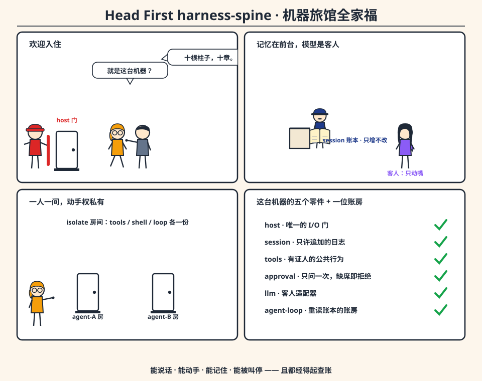

> 姊妹篇：[写给所有人的 Harness](../../harness-for-everyone/HARNESS_FOR_EVERYONE.md)（概念版）、[harness-spine 是怎样工作的](../../how-harness-spine-works/HOW_HARNESS_SPINE_WORKS.md)（源码版）、[从零构建 harness-spine](../build-harness-spine-from-scratch/BUILD_HARNESS_SPINE_FROM_SCRATCH.md)（动手版）。

---

## 怎么用这本书

这不是一本「读完就算」的书。Head First 的老规矩：**我们希望你一边笑，一边把概念焊进脑子里**。所以每一章你都会遇到：

- **一幅漫画**——把抽象机制画成一台你看得见的机器；
- **没有笨问题**——你刚想说「等等，那……」的时候，我们就替你问了；
- **动一动**——每一个概念都连着一个**真的能跑**的实验（用真实仓库里的教学切片，跑完会打印 `LAB-OK`）；
- **脑力充电站**——几道小题，答案就翻在下面，但请先自己想十秒；
- **速记卡**——合上书之前扫一眼的那张卡。

这条学习路线的押注是：**智能体不是「围着厂商 SDK 写个循环」**。它是一台小机器——能说话、能动手、能记住、能被叫停，而且这四件事都经得起追问。十 章 结束时，你会亲手跑过这台机器的每一个零件。

先跑一下环境检查（需要 `PATH` 上有 `r3`，即 Rebol 3）：

```bash
cd ../../how-harness-spine-works
./verify-all.sh
# expect: 10/10 OK
```

看到 10/10，就翻页。

---

# 第 1 章 你以为你在写智能体，其实你在写循环

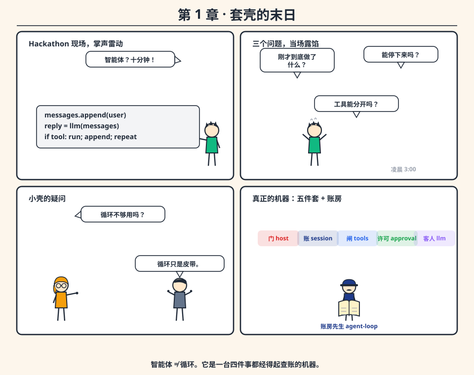

**深夜的hackathon现场。** 阿粗拍着胸脯：「智能体？十分钟！」——`messages.append(user)`、`llm(messages)`、工具一跑、结果一塞、循环再来一遍。台下掌声雷动。

凌晨三点，产品经理发来三个问题，阿粗的套壳当场露馅：

1. 「刚才那次调用，模型**到底**看到了什么？」
2. 「能让它**停下来**吗？别撒谎的那种停。」
3. 「第二个智能体能不能不跟第一个**共用工具箱**？」

循环早就把证据扔了。它没有协议，只有 `Ctrl-C`。两个智能体一上场，工具表就撞车。

> **你以为**：智能体 = 模型 + 循环。
> **其实**：循环只是传动皮带。真正的机器是——一扇门（副作用）、一本账（记忆）、一道审批缝（许可）、一位客人（模型）、一位重读账本的账房先生（控制流）。SDK 循环五样缺四样。

## 机器的四条底线

harness-spine 是一个很小的 Rebol 运行时，它把上面三个问题当成**产品本身**来回答。它的赌注可以背下来：

> **智能体是一台能说话、能动手、能记住、能被叫停的机器——而且这四件事，都经得起从日志里查账。**

「经得起查账」是关键词。不是「看起来能」，是「日志里每一行都对得上」。模型在这台机器里是**客人**：可以发言，不当家；不带记忆，不碰 I/O。

### 先看一眼这台机器的全身图

```text
cordis-port 内核（ctx, plugin, waterfall, isolate）
  -> host            唯一的 I/O 门
  -> session         只许追加的日志；聊天是一种视图
  -> tools           pre / execute / post + tools-result
       -> shell      bash 是一份登记过的规格，不是循环的原语
  -> approval        一次性，缺席即拒绝，两边都写进日志
  -> llm             客人：enqueue / script / http / echo
  -> agent-loop      一个重读日志的回合
  -> scope + agent   私用的动手房间，共享的前台
  -> boot / yaml / reload
```

别慌，每一根柱子后面都有一章。你现在只需要记住三件事：**门只有一扇、账只增不改、客人不下场动手。**

## 没有笨问题

**问：我用的框架（LangChain / 某Agent SDK）很好啊，为什么要自虐？**

答：不冲突。那些框架管的是「怎么把活干得更顺」，harness-spine 管的是「怎么让每个动作都对得上账」。前者是家具新品目录，后者是承重墙。本书的全部实验都跑在真实源码上——你随时可以打开每一个 `api.reb` 对照。

**问：Rebol？这语言我连听都没听过。**

答：这正是选它的原因——它小到你可以**读完**。全书只要求你认得几种形状：`map!`（花括号字典 `#[key: value]`）、`block!`（方括号列表 `[a b c]`）、word（`'bash` 这种带引号的名字）。跟着漫画走，你不会迷路。

## 动一动：让机器说第一句话

```bash
cd ../../how-harness-spine-works/ch01-echo-turn/code
bash run.sh
```

预期看到（关键行）：

```text
STATUS: text
ASSISTANT: hello from spine
--- event types ---
[turn-start user-message step-start assistant-chunk assistant-message step-end turn-end]
LAB-OK
```

注意 `ASSISTANT: hello from spine`——**没有一个真的模型在场**。默认适配器是 echo：它只是把你的话原样读回来。而这恰恰是重点：连「假模型」都能把一个回合走完整，说明协议本身站得住。

## 脑力充电站

1. 阿粗的套壳里，`messages` 数组同时扮演了哪两个角色？
2. 「取消 = Ctrl-C」违背了四条底线中的哪几条？
3. echo 适配器证明了什么、没证明什么？

<details><summary>答案</summary>

1. 记忆 + 模型输入。所以工具一多、流式一来，两份历史必然对不上账。
2. 至少两条：能被叫停（没有协议，只有杀进程）＋ 经得起查账（session 里留下没写完的鬼魂）。
3. 证明了**回合协议**不依赖厂商；没证明真实模型的适配器——那是第 6 章的事。
</details>

## 速记卡

- 套壳的死因：记忆与输入同源、副作用无门、取消无协议、工具表共用。
- harness-spine 五大件：host（门）/ session（账）/ tools（证人）/ approval（许可）/ llm（客人），外加 agent-loop（账房先生）。
- 一切实验以 `LAB-OK` 收尾；`./verify-all.sh` 应为 10/10。

---

# 第 2 章 一条「hello」的奇幻漂流

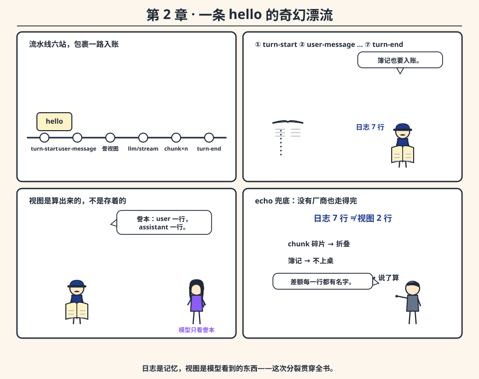

你敲下 `hello from spine`，回车。这条字符串接下来去哪了？本章跟着它走完全程——**这是全书最重要的一章**，后面九章都在给这条流水线加岗哨。

## 流水线六站

`driver/run-turn` 一开口，机器就开始记账：

1. **`turn-start`**——回合开幕，账本上先落一行（空载荷，纯簿记）。
2. **`user-message`**——你的话原文入账。从此它是**历史**，不是变量。
3. **誊一份视图**——`derive-messages` 从账本现场算出「模型可见的聊天记录」。注意：是**算**出来的，不是存着的。
4. **问客人**——`llm/stream` 收到视图，吐出若干截文本；每截都记一行 `assistant-chunk`。
5. **合体**——流结束后，一条最终的 `assistant-message` 入账，chunk 碎片在视图里被折叠。
6. **`turn-end`**——带着 `status`、`steps`、`text` 三样收工。

**日志里落了七行，模型看到的视图却只有两行**（一条 user、一条 assistant）。这个差值不是浪费——它就是「账本 vs 誊本」的第一次现身。

> **你以为**：聊天记录就是历史。
> **其实**：聊天记录是**视图**，历史是**日志**。视图随时可以扔掉重算；日志一行都不许改。

## echo 的宣言

默认适配器 `resolve-reply` 的查找顺序是：队列 `enqueue` → 外部脚本 → HTTP → **echo 兜底**（把 `last-user-content` 原样读回）。所以第一回合里，「模型」其实是一面镜子。

这不是偷懒，是**实验设计**：如果协议必须靠真模型才能跑通，那协议就把自己卖给了厂商。echo 在说：**没有客人，这台机器照样把一个回合走完整。**

## 没有笨问题

**问：为什么每个 chunk 都要单独记账？合并成一条不行吗？**

答：流式回复中途取消、重试、崩溃时，**chunk 是唯一诚实的证据**。合并发生在视图层（誊本上），原始事实留在日志层（账本上）。誊本可以错，账本不会。

**问：`derive-messages` 每一步都重算，不浪费吗？**

答：浪费一点 CPU，买到的是「缓存永远不可能过期」。第 7 章你会看到，多少「诡异的工具表漂移」都是缓存惹的祸。

## 动一动：给流水线加戏

```bash
cd ../../how-harness-spine-works/ch01-echo-turn/code
bash run.sh   # 先看基线
```

然后打开 `demo.reb`：

1. 把用户字符串改成 `"ping"`——助手应当原样回声（`last-user-content` 的功劳）。
2. 在 `run-turn` 之前 `enqueue` 一条 `text: "not-an-echo"` 的回复——队列排在 echo 前面，输出会变。
3. 打印 `length? spine/sessions/events-of s/id` 和 `length? spine/sessions/derive-messages s/id`——亲眼看 7 对 2 的落差。

## 脑力充电站

1. `turn-start` 的载荷是空的，为什么还要记？
2. 如果流式中途崩溃，日志里会留下什么？视图里会留下什么？

<details><summary>答案</summary>

1. 簿记也是事实。「这个回合什么时候开始」本身就是审计问题。
2. 日志：若干 `assistant-chunk`，一条不少；视图：残余 chunk 拼成一条半截的助手消息。下次重算视图，机器（和人）都能看见「上次说到一半」。
</details>

## 速记卡

- 回合流水线：`turn-start → user-message → derive → llm/stream → assistant-chunk×n → assistant-message → turn-end`。
- 日志 7 行、视图 2 行——差额 = 簿记 + chunk + 折叠规则。
- echo 兜底 = 协议独立于厂商的宣言。

---

# 第 3 章 记忆是账本，聊天是誊本

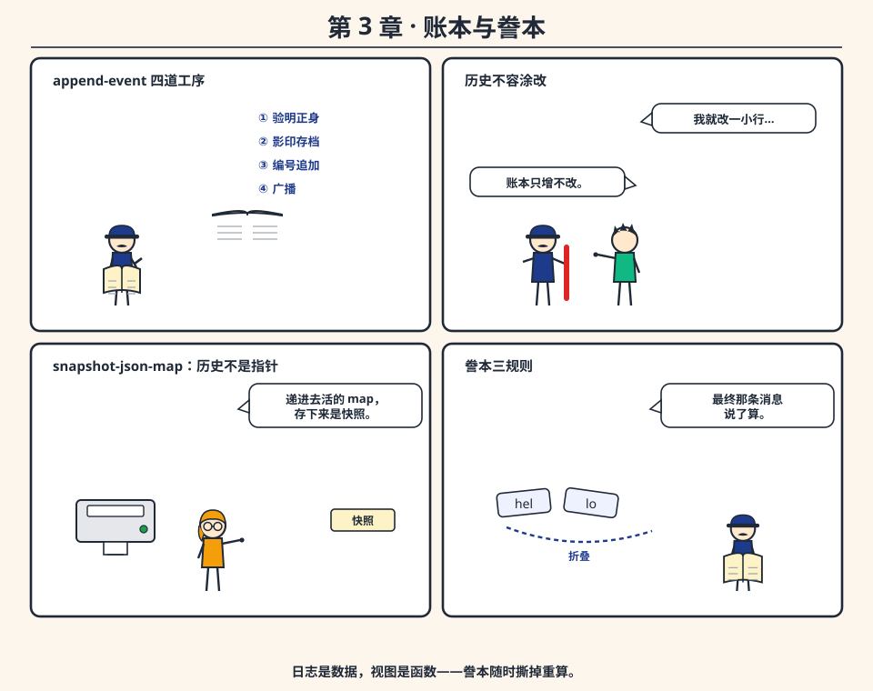

第 2 章末尾那个「7 对 2」，本章掰开揉碎。

## 一本只许追加的账本

脊柱的记忆是**事件日志**：每次 `append-event` 都是一条带编号的记录。三道工序，缺一不可：

1. **验明正身**——`validate-payload` 拒绝未知事件类型、拒绝载荷不合规矩（比如 `text` 不是字符串）。历史不容错别字。
2. **影印存档**——`snapshot-json-map` 把载荷深拷贝快照。你递给它一张**活的** map，转手改了 `text`，账本上仍是改之前的值——历史不是插在你堆里的指针。
3. **编号追加**——赋上连续的 `index`，追加，广播 `session-event`。只增不改，是这本账的全部纪律。

最省事的替代方案是 OpenAI 式数组：`[{role: user, content: ...}, ...]`，整个数组每回合塞给模型。可助手回答一旦流式拆碎，这套设计就垮了：chunk 算一条消息吗？缓冲到一半崩了丢谁的？——**数组把「存储格式」和「传输格式」焊死在一起**，账本不犯这个错。

## 誊本的三条规则

`derive-messages` 把账本走一遍，产出模型可见的聊天：

- `user-message` / `assistant-message` → 直接誊；
- 连续的 `assistant-chunk` → 先折进缓冲，一旦后面跟着 `assistant-message`，**最终那条说了算**，缓冲作废；
- `tool-call` → 誊成带 `kind: 'tool-call` 的助手行，`tool-result` → 誊成 `role: 'tool` 行；回合簿记（`turn-start`、`step-end`、审批事件）一概不上誊本。

> **你以为**：誊本就是账本的摘要，少几行而已。
> **其实**：誊本是**函数**，账本是**数据**。函数永远可以重跑，数据永远只有一个真相。

## 开分支：另起一本账

`fork` 把前缀拷进一个新 session id，两本账从此各写各的。没有「共享数组 + 写时复制标志」这种等着你去搞错的机关。持久化同理：设了 `store-dir`，每次追加都把整本账的 `mold/all` 落盘成 `<id>.events.reb`；重启后 `open` 校验重载——**持久化是配置项，不是藏起来的全局变量**。

## 没有笨问题

**问：为什么不存 JSON？**

答：`json-map?` 连函数、循环引用对象都不收——它们没法安全重放。Rebol block 直接 `mold/all` / `do` 往返，格式和语言同源，没有第二套序列化器要维护。

**问：诚实的代价是什么？**

答：啰嗦。一次 echo 回合七行事件。但审计从来不怕行数多，只怕行数不可信。

## 动一动

```bash
cd ../../how-harness-spine-works/ch03-session-log/code
bash run.sh
```

看四件事：`FROZEN: before`（快照生效）、`FOLDED: hello`（chunk 折叠）、`MESSAGE-WINS: hello-final`（最终消息说了算）、`REOPENED: persist me | ok`（重启后账本完整）。「试一试」里还有一个坏主意验证：注释掉 `assistant-message` 那行，看誊本怎么表现。

## 脑力充电站

两条 `assistant-chunk`（`"hel"`、`"lo"`）之后又来一条 `assistant-message`（`"hello-final"`）。誊本里助手有几行？内容是什么？

<details><summary>答案</summary>

一行，内容 `"hello-final"`。chunk 缓冲被最终消息清掉。若 `assistant-message` 没来，则同样一行，内容 `"hello"`——缓冲兜底，一截都不丢。
</details>

## 速记卡

- `append-event` = 验类型 + 快照 + 编号 + 广播。
- 誊本规则：chunk 折叠、最终消息优先、簿记不上桌。
- fork = 另起一本账；持久化 = 配置，不是全局变量。

# 第 4 章 工具不是函数调用，是带证人的公共行为

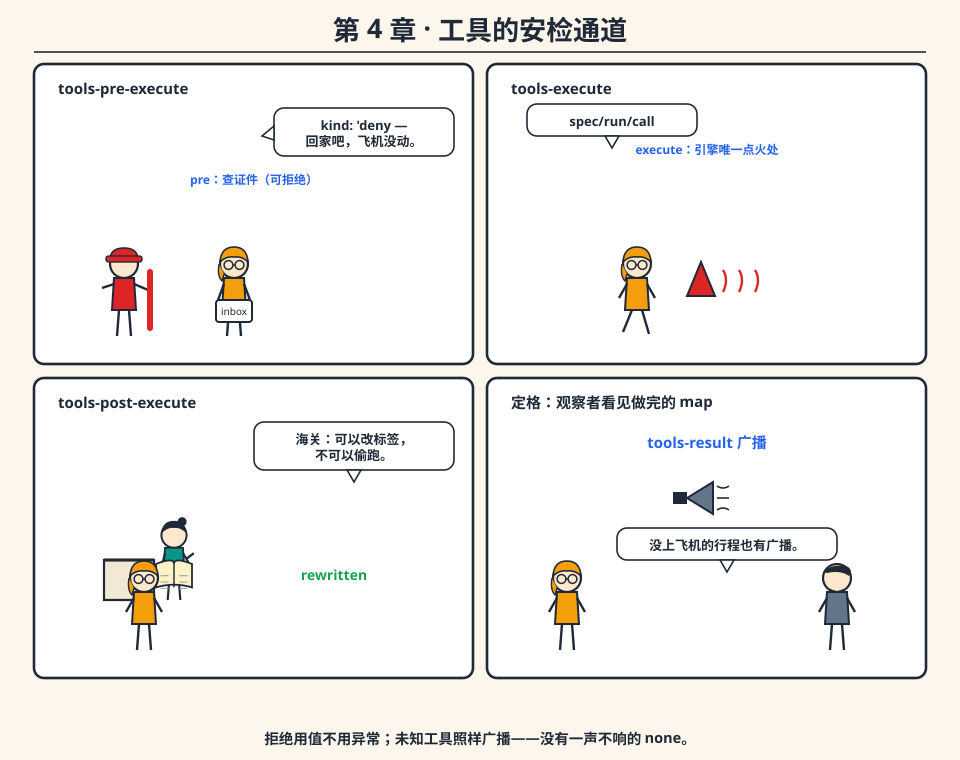

工具看起来最无害：有名字、有参数、有结果，`do registry[name](args)` 一行完事。阿粗的函数表就是这么长的。可 «第一次 «就这一回» 的 `if name = 'bash [check ...]`» 迟早长成第二套解释器——因为函数调用是**私下的**：没有时机让策略在函数存在之前说不，没有事件让旁观者围观，没有槽位让测试替身站进去。

harness-spine 把工具当成**一次有证人在场的公共行为**：`tools/execute` 先造一份 `exec` map（`name`、`args`），然后让这份材料**依次穿过三条 waterfall**，最后广播 `tools-result`。

## 安检通道四段式

| 阶段 | 机场比喻 | 默认内层做的事 | 监听者能干什么 |
|------|----------|----------------|----------------|
| `tools-pre-execute` | 查证件 | 返回 `#[kind: 'allow]` | 交回 `kind: 'deny`——本体碰都不碰，实验里计数器停在 0 |
| `tools-execute` | 引擎点火 | 调 `spec/run/call`（**唯一点火的地方**） | 包住内层（重试、计时），或再次拒绝 |
| `tools-post-execute` | 海关开箱 | 原样递出结果 | 改写输出（实验里文本被换成 `"rewritten"`）——涂黑可以，偷跑不行 |
| `emit tools-result` | 大喇叭广播 | 往 `result-log` 追加并广播 | 只能旁听，本体已经定格 |

关键设计只有一句：**副作用只发生在 `tools-execute` 的内层里（或因为本体调了 host 而发生在 host 里）**。pre 不干活，post 不干活，广播之后没有撤回。

> **你以为**：工具 = 函数，跑没跑只有调用方知道。
> **其实**：工具 = 公共行为，跑没跑、跑出什么，广播里见。连「根本没离开柜台的行程」（被 pre 拒掉的）都有一条 `tools-result`。

## bash 也是普通旅客

`shell-plugin` 登记了一份名叫 `'bash` 的规格，它的 `call` 就是转手调 `host/run-command`。循环要跑工具时，调的是 `tools/execute/meta`，**从不认识 bash，也从不认识 host**。所以「bash 有什么特权」这个问题不存在——特权在结构里，不在名单上。

## 没有笨问题

**问：为什么拒绝要用「值」（`kind: 'deny`）而不是抛异常？**

答：拒绝是一个**需要入账的结果**，不是程序故障。抛异常的语义是「世界出错了」，而 deny 的语义是「世界正常，但这次不行」。值可以被记录、被广播、被测试；异常只会把栈拆了。

**问：监听者忘了调内层 `nw/call` 会怎样？**

答：整条流水线停在他手上——内层被吞，本体不跑。这是 waterfall 的纪律成本：接力棒必须传下去。

## 动一动

```bash
cd ../../how-harness-spine-works/ch04-tools-waterfall/code
bash run.sh
```

对答案：`PRE-DENY: pre-denied calls=0`（拒绝在点火之前）、`POST-REWRITE: rewritten calls=1`（工具真跑了、文本被换掉）、`BASH-STDOUT: through-host`（bash 走的是 host 门）。「试一试」第 2 条让你亲手复现 exec-stage deny。

## 脑力充电站

1. pre 监听者返回 `kind: 'deny` 后，`spec/run/call` 会跑吗？`tools-result` 会广播吗？
2. post 阶段把结果改写掉，算不算「干了私活」？

<details><summary>答案</summary>

1. 不跑；广播。**没有一声不响的拒绝**——这正是「带证人」的含义。
2. 改写输出是 post 的职责（涂黑/脱敏），但改写发生在广播**之前**、由广播见证。偷跑的定义是「绕过广播干活」，而不是「在镜头前改写」。
</details>

## 速记卡

- 三条 waterfall：pre（拒绝闸）→ execute（唯一点火）→ post（改写窗），随后 `tools-result` 定格广播。
- 未知工具 → `#[ok false error "unknown-tool"]`，照样广播。
- 一次「hello world」四个名字——这是**可审计的代价**，不是啰嗦病。

---

# 第 5 章 只问一次，缺席即拒绝

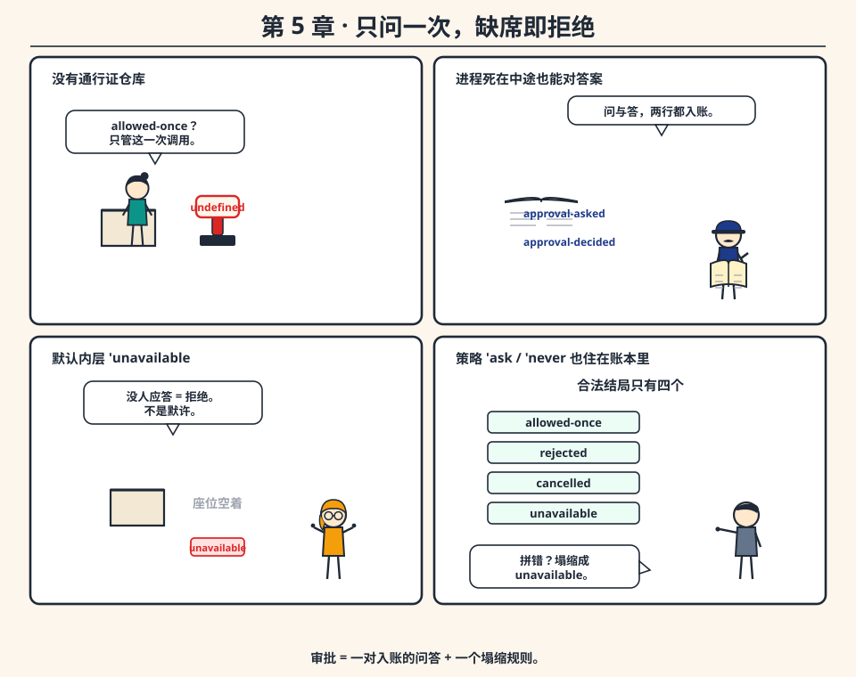

工具能拒绝（第 4 章），不等于有人说了「允许」。审批要回答的是：**谁来点头，点头的证据放哪。**

## 这道接缝的纪律

`approval/request` 只在**打开的回合内**工作（有 `turn-start` 还没有 `turn-end`，否则直接报错——漂在两个回合之间的许可没人有义务尊重）。它做四件事：

1. 造一个 id（`a<随机数>`）；
2. 账本记一行 `approval-asked`——**问题入账**；
3. 把问题送进 `approval-request` waterfall。默认内层返回 `'unavailable`——**没有内置界面**，没人应答本身就是一条被记下的结局；
4. 不管结局是什么，账本再记一行 `approval-decided`——**答案入账**。

结局只有四个合法值：`allowed-once`、`rejected`、`cancelled`、`unavailable`。**其它一切——包括界面钩子上的一个拼写错误——一律塌缩成 `'unavailable`**。缺省即拒绝（fail-closed），拼写错误不配变成通行证。

> **你以为**：审批 = 一个布尔开关。
> **其实**：审批 = 一对入账的问答 + 一个塌缩规则。布尔值会在这段代码里默认 true、在另一个代码库里默认 false，两边都不留痕迹；账本两边都写，谁也别想装傻。

## 「仅此一次」的准确含义

`'allowed-once` 管的是**这一次调用**，不是「这件工具本周随便用」。没有通行证仓库（grant store）这种东西——想跨调用记住「用户点过一次头」，那是你自己的监听者该造的轮子，而且它也必须写下可以回放的东西。

策略同样住在账本里：`set-policy` 记一行 `approval-policy`（`'ask` 或 `'never`），`effective-approval-policy` 倒着扫事件找最近一行。**同一个 session 可以先宽松后收紧**，回放时转变发生在哪一刻一目了然。

## 没有笨问题

**问：为什么「回合外请求审批」要直接抛错？这么严酷吗？**

答：想象一行审批记录漂在两个回合之间——机器握着一个人的决定，却没有任何 driver 有义务尊重它。「缺席即拒绝」也包括「现在不行」。

**问：那我的产品要弹确认框，在哪弹？**

答：脊柱不管 UI。你把一个监听者挂到 `approval-request` waterfall 上，返回 `'allowed-once` 或 `'rejected`。命令行提示、聊天按钮、CI 里永远拒绝——都行。脊柱只保证：**问和答都上了账，而且问不出去不等于默许。**

## 动一动

```bash
cd ../../how-harness-spine-works/ch05-approval-once/code
bash run.sh
```

对答案：`NEVER: rejected`（策略不问人）、`NO-ANSWERER: unavailable`（缺席即拒绝）、`TOOL-DENIED: #(false)` / `TOOL-GRANTED: allowed-body`（同一工具，两种命运）。「试一试」让你给回答者喂一个字符串 `"sure"`，看它怎么被塌缩成 `unavailable`。

## 脑力充电站

产品在提问中途死机。重启后，你能从日志回答「用户到底答没答过」吗？

<details><summary>答案</summary>

能，而且答案很干净：只有 `approval-asked` 没有 `approval-decided` = 问题问出去了、答案没回来。布尔方案此刻只能两眼一抹黑——这正是「两边都写」存在的理由。
</details>

## 速记卡

- 流程：`approval-asked` → waterfall → `approval-decided`，两次入账。
- 四个结局，其余全塌缩为 `'unavailable`；默认策略 `'ask`，策略也入账。
- 没有通行证仓库；`allowed-once` 只管一次。

---

# 第 6 章 模型是客人，不当家

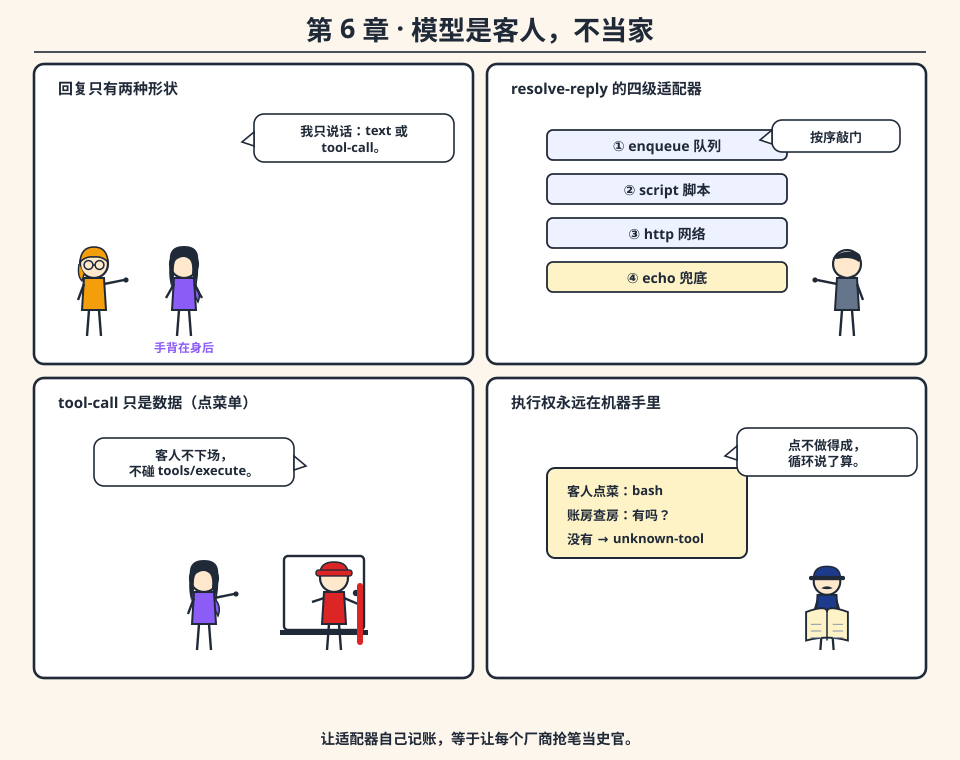

到这里机器能记住、能动手了。最后的诱惑是让模型当家：SDK 递进消息、递出 JSON，`tool_calls` 一解析就直接跑——「套壳」就是这样变成远程代码解释器的。厂商超时、schema 漂移、流重试，你的 session 成了「上一份 HTTP 正文碰巧长成的样子」。

harness-spine 把关系倒了过来：**循环向 `llm` 服务要一份回复，回复是一份很小的 map**——`#[kind: 'text text: ...]` 或 `#[kind: 'tool-call name: ... args: ...]`。就这样。没有第三种形状。

## 客人的四扇传声筒

`resolve-reply` 按顺序敲门：

1. **`enqueue` 队列**——测试脚本投递的回复，永远最优先；
2. **外部脚本**——`llm/script.reb` 把请求 `mold` 进临时文件，调 `r3 -q` 跑你的脚本，解析 stdout；
3. **HTTP**——`llm/http.reb` 经 host 发 post（流式则走行协议：`#[delta "..."]` 一行行吐）;
4. **echo 兜底**——把最后一条用户内容原样读回。

客人不许做的事只有两件：**自己另挑一个 session**，或者**自己去调 `tools/execute`**。一份 `tool-call` 回复只是数据——名字存不存在、要不要审批、取消提没提，都由循环决定。

> **你以为**：适配器 = 发 HTTP 的一小段代码。
> **其实**：适配器 = 客人的嘴。它只负责说话（文本或 tool-call 数据），记账、执行、审批、取消全部归机器。让适配器自己追加事件，等于让每个厂商都变成互相抢笔的史官。

## 没有笨问题

**问：为什么 `enqueue` 要排在最前面？真模型来不了吗？**

答：队列是**脚本化适配器**——测试和教学用它固定客人要说的话。次序固定意味着：同一个实验，今天跑和明年跑结果一致。真模型走 script 或 http 那两扇门。

**问：流式适配器想「把 token 直接丢给界面」为什么这么麻烦？**

答：因为 chunk 的记账归循环。适配器要么填好 `chunks`，要么按行协议说话；界面挂在 sink 上收货。多一道手续，换来的是**界面永远看到和账本一致的东西**。

## 动一动

```bash
cd ../../how-harness-spine-works/ch06-llm-guest/code
bash run.sh
```

对答案：`ECHO: hello guest`（四扇门全空时的兜底）、`ENQUEUED: from-queue`（队列插队）、`TURN-TYPES` 里两条 `assistant-chunk`（流式入账）。「试一试」第 2 条最损也最妙：chunk 说 `"hel" "lo"`、`text` 却说 `"mismatch"`——看机器怎么诚实地把两份都记下来。

## 脑力充电站

一份 `kind: 'tool-call` 回复提议了 `'bash`，但当前智能体的房间里根本没登记 bash。谁负责发现？日志里会出现什么？

<details><summary>答案</summary>

循环（`tools/execute` 里查 `registry`）。日志里先出现提议的 `tool-call`，随后是一条 `#[ok false error "unknown-tool"]` 的 `tool-result`——客人可以乱点菜，账本记录「点了、没做成」，一切有据可查。
</details>

## 速记卡

- 回复形状只有两种：`text` / `tool-call`。
- 敲门次序：queue → script → http → echo。
- 客人不下场：不挑 session、不执行工具、不碰 host。

---

# 第 7 章 账房先生的早晨：每一步都重读账本

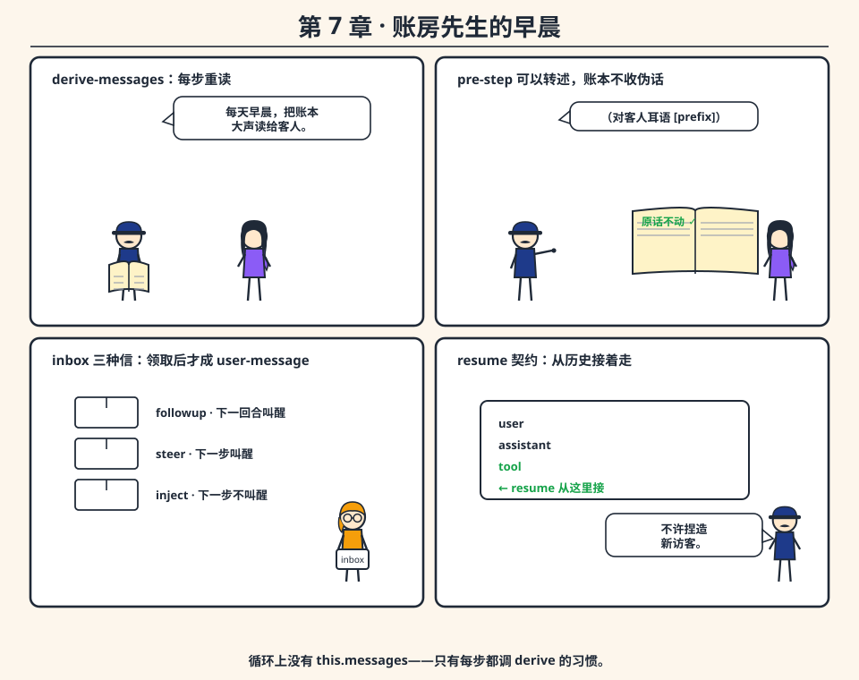

现在把镜头对准控制流。最省事的想象里，一个回合 = 一个可变的对话对象 + while 循环：追加、调用、再追加。那个活数组*就是*状态——第 3 章它在存储上失败过，本章它作为**控制流**再败一次：中途取消时数组里有没结果的 tool-call；想恢复时分不清该不该再塞一行用户记录；插件想改模型输入就得改界面正在打印的同一个数组。

`run-turn-core` 的答案是：**循环不持有对话，循环每一步都重读账本。**

## 回合的心跳

```text
标记 live-session-id → turn-start → 领取 inbox → (可选拟用户文本)
→ 每一步: 取消检查? → max-steps? → step-start
   → derive-messages（重读账本）
   → agent-pre-step waterfall（可改写可拒绝）
   → agent-request waterfall（可换供应商）
   → llm/stream → tool-call/tool-result 或 assistant-message
   → step-end
→ turn-end（status: text / max-steps / rejected / cancelled）
```

三个细节值得盯住：

- **`derive-messages` 每步都调**。模型看到的输入永远是账本的**最新誊本**——工具结果一入账，下一步模型就「听见」了，不需要谁去手动同步。
- **pre-step 可以对客人耳语**。实验里监听者给用户内容加前缀 `"[prefix] "`，echo 于是一句带前缀的话——誊本被改了，**账本上的原始用户行纹丝不动**。账房先生可以对客人转述，笔记本不收伪造的人话。
- **inbox（`followup` / `steer` / `inject`）也是账**。信件被领取后才落成 `user-message` 行——走和人打字一模一样的路，模型没有第二条输入通道。

> **你以为**：resume = 「接着上次的话茬，再骗一次模型说用户说话了」。
> **其实**：resume 只允许两种入场券——誊本以 `tool` 或 `assistant` 收尾；或 inbox 里有 `followup`/`steer` 叫醒循环。**不许捏造一位新访客。**

## 没有笨问题

**问：为什么光秃一条 user-message 不能 resume？**

答：`can-admit-turn?` 不把「已经有一行用户记录」当成该去叫模型的理由——那行可能是还没跑完的 turn、手工塞进账本的种子，或取消留下的半截。放行只认两种入场券：誊本以 `tool`/`assistant` 收尾，或 inbox 里有 `followup`/`steer`。`test/session-fork-test.reb` 锁住了这条边：孤零 `user` → `no-input`；先跑完一轮再 resume → 不捏造第二行用户。

**问：重读的代价呢？长会话会不会越来越慢？**

答：会，这是实打实的 CPU。但对照方案——缓存上次誊本——正是取消或 fork 之后「工具表悄悄过期」的根源。花 CPU 买正确性，这笔账在 agent 场景下永远划算。另外有一道闸：`max-steps`（默认 8），一个只会回 tool-call 的客人不许永远跑下去。

## 动一动

```bash
cd ../../how-harness-spine-works/ch07-the-turn/code
bash run.sh
```

对答案：`TOOL-ROLES: [user assistant tool assistant]`（工具结果入了誊本）、`RESUME-ROLES: [user assistant assistant]`（resume 没捏造第二行用户）、`RESUME-USER-ROWS: 1`。「试一试」第 3 条让你塞九次 tool-call，看 `max-steps` 闸门落下。

## 脑力充电站

一次 tool-call 步骤之后，下一轮模型输入里的工具结果从哪来——循环上的某个变量，还是账本？

<details><summary>答案</summary>

账本。`tool-result` 入账后，下一步 `derive-messages` 重算誊本时自然包含它。循环上没有 `this.messages` 字段——这就是「没有缓存」的准确含义。
</details>

## 速记卡

- 循环 = 账房先生：每步重读、可以转述（pre-step）、不许伪造（resume 契约）。
- inbox 三种信：followup（下一回合叫醒）、steer（下一步叫醒）、inject（下一步不叫醒）。
- 状态机：`text` / `max-steps` / `rejected` / `cancelled` / `no-input` / `disposed`。

# 第 8 章 一人一间房：两个智能体的和平共处

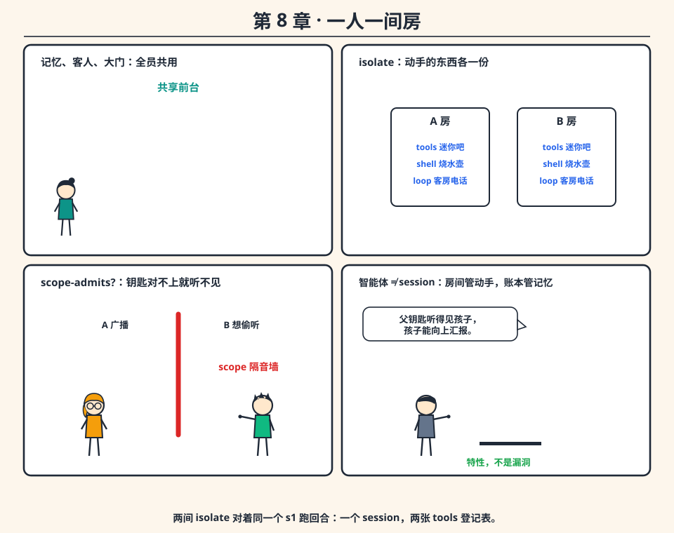

如果 tools、shell、循环都是根上的公共服务，两个智能体就会共用一张登记表、同一面取消旗：在 A 上登记 `whoami`，会改掉 B 跑的东西；取消 A，也就取消了 B；监听 `tools-result`，等于听见所有人。阿粗会说：「一个全局工具箱多省事！」——在第二个智能体出现之前，它确实显得更简单。

harness-spine 的做法：**每个智能体分到一间 isolate 房间，前台共享。**

## 房间与钥匙

`create-agent-handle` 四步造房：

1. **铸钥匙**——`mint-scope-key` 产出一把不透明的对象钥匙（你没法解析它，只能拿着它）；
2. **（可选）认亲**——`bind-scope-parent` 把孩子钥匙挂到父钥匙上；
3. **隔房间**——`extend-agent-iso` 把 `tools`、`shell`、`agent-loop` 三个插件放进 isolate-map，键名 `agent-<label>`——每个智能体**各有一份**；
4. **发钥匙**——钥匙挂进房间 ctx，handle 上的 `tools` 和 `driver` 都从**这间房**里查。

前台（`session`、`llm`、`host`）留在根上：所有智能体共享记忆、共享客人、共享那扇门。

## 事件跟着钥匙走

工具执行广播 `tools-result` 时，带着自己的钥匙（`make-scope-target`）；监听者`scope-admits?` 从派发钥匙沿父链核对——**A 的监听者听不见 B 的动静，兄弟姐妹不能横着偷听**。唯一的例外是父钥匙：实验里铸出 `parent`，用它拉起 `child`，把父钥匙挂到根上——根上的监听者就能听见孩子的广播。**孩子可以向上汇报，这是特性不是漏洞。**

> **你以为**：「智能体 = session」。
> **其实**：两个 isolate 房间可以对着同一个 session id 跑回合（共享记忆、说话人换了账本不换）；也可以 `fork` 出两本账（记忆隔离）。**房间管动手权，账本管记忆，两件事独立配置。**

## 没有笨问题

**问：为什么 YAML 里列的是 host/session/approval/llm/agents，没有 tools？**

答：因为 tools 是**每个智能体的私产**，由 `create-agent-handle` 装进房间，不走根装配。盯着 YAML 问「bash 在哪」，是问错了层——这个「故意不在场」第 10 章还会再考一次。

**问：钥匙为什么要做成不透明对象，一个字符串不是更方便？**

答：字符串会被打印、被猜、被伪造。不透明对象只能被**持有**，而持有关系（谁拿的是谁发的钥匙）正是权限的本义。scope 的路由逻辑因此不必去载荷里翻一个 id。

## 动一动

```bash
cd ../../how-harness-spine-works/ch08-isolate-rooms/code
bash run.sh
```

对答案：`WHO-A: A / WHO-B: B`（同名工具各归各）、`B-HEARD-A: #(false)`（横着偷听失败）、`PARENT-HEARD-CHILD: #(true)`（向上汇报成功）。「试一试」第 3 条用 `reflect/get` 验证：session 从父链解析，tools 则不该。

## 脑力充电站

两间 isolate 都对着 `s1` 跑回合：存在几个 session 对象？几张 `tools` 登记表？

<details><summary>答案</summary>

一个；两张。前台共享所以账本只有一本——四条消息（A 说的、echo、B 说的、echo）在同一个 id 下排队；动手的登记表各房一份。这正是「私人动手、共享记忆」的字面意思。
</details>

## 速记卡

- isolate 三件套：`tools` / `shell` / `agent-loop`，键名 `agent-<label>`；前台三件套：`session` / `llm` / `host`。
- 事件路由靠 scope 钥匙与父链，不靠载荷翻 id。
- 父钥匙听连通房，兄弟姐妹互相隔音。

---

# 第 9 章 停下，但不撒谎

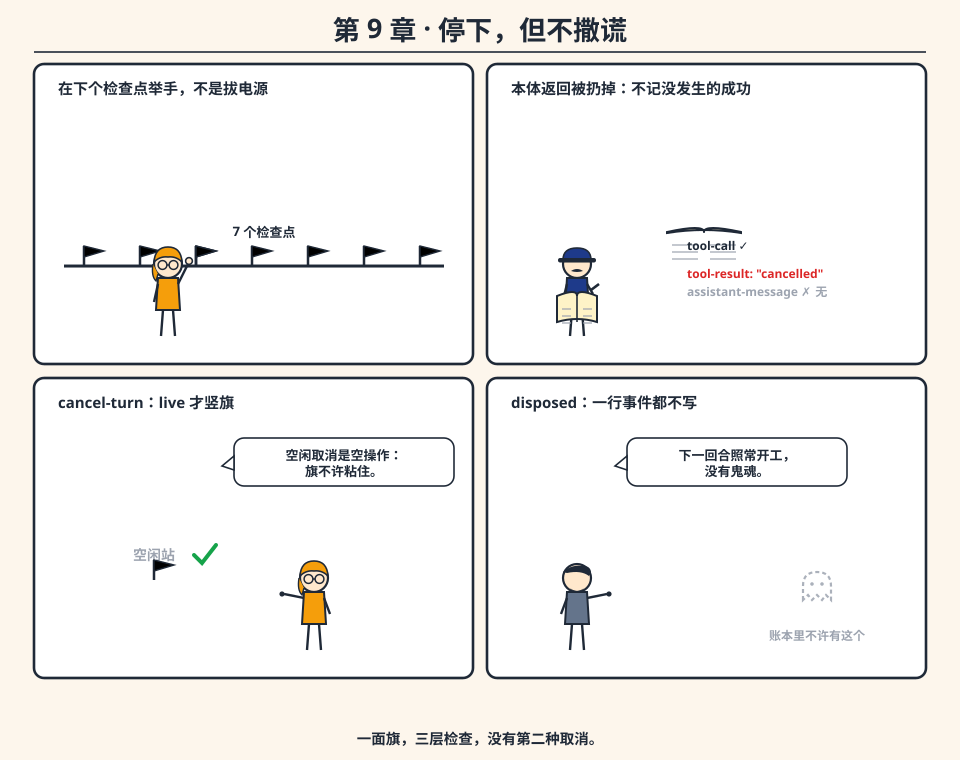

启动一个回合值得庆祝，**停下才是套壳开始撒谎的地方**。`Ctrl-C`、`kill`、回调里抛异常——进程没了，session 里却留下一次没有结果的 `tool-call`，或一段「模型突然哑火」的半截流。下一次誊本把这段没写完的故事当历史，送给新模型：**账本里住进了鬼魂。**

## 协作式取消：一面旗，三层检查，没有第二种取消

`cancel-turn` 只在**回合活着**的时候竖旗（`live-session-id` 是字符串）；driver 空闲时它返回 `none`，**不**留下旗标——一面粘在空闲上的旗，会把下一回合无辜的工作也取消掉。

旗竖起来之后，机器在七处检查点张望：步进循环开头、`step-start` 之后、流结束之后、execute 之前、execute 之后，以及每次 settle 泵调度器的时候（tools 的 `settle/cancel`、LLM 的 stream、host 的 `http-post-stream`——最后那位取消的方式是**杀掉 curl 的 pid**）。任何一处看见旗，回合立即收束：

- 已提议未执行的工具调用，落一条特殊的 `tool-result`：`#[text: "cancelled" cancelled: true]`——**没做完就是没做完，白纸黑字**；
- 回合以 `status: 'cancelled` 收工，旗自动降下。

> **你以为**：取消 = 把正在跑的东西掐死。
> **其实**：取消 = 「在下一个检查点举手」+「在账本上写下 cancelled」。它不撤销已经发生的事（外部 API 已经提交的请求没有两阶段中止），它只拒绝**记下一笔没有发生的成功**。

## 拒绝假装

dispose 之后的 `run-turn` 也不含糊：Fiber 已经不活着，`turn-cancelled?` 直接为真，回合返回 `status: 'disposed`、steps 0、**一行事件都不写**。机器不下线时假装开工，也不下线时假装下线。

## 没有笨问题

**问：一个死循环的工具不理旗，怎么办？**

答：要到它自己返回才看得见旗——协作式取消的天花板。脊柱没法把「对不可打断二进制的一次 `call/wait`」变成事务。它守住的下限是：**宁可让世界慢一点，不让账本脏一点。** 真要硬杀进程？只有当你连 session 一起扔掉时才算诚实。

**问：取消后队列里还没消费的回复去哪了？**

答：原地待命。下一回合照常取用——实验里取消后换新 session echo `"next"`，一切正常。取消不弄脏进程，只诚实了账本。

## 动一动

```bash
cd ../../how-harness-spine-works/ch09-cancel-protocol/code
bash run.sh
```

对答案：`IDLE-CANCEL: _` + `IDLE-FLAG: #(false)`（空闲契约）、`HAS-TOOL-CALL: #(true)` / `HAS-TOOL-RESULT: #(true)` / `HAS-ASSISTANT: #(false)`（提议入账、取消入账、假回答缺席）、`RESULT-TEXT: cancelled`。「试一试」第 3 条连按两次空闲取消，两次都该是 `_`——**旗不许粘住**。

## 脑力充电站

abort 工具的本体其实跑完了并返回了 `"abort-body"`。为什么日志里没有这个字符串？

<details><summary>答案</summary>

取消检查点在「本体返回之后」仍然有效：循环拒绝把一个取消回合的返回值当成正常结果，改写为 `cancelled-tool-result`。本体的产出被扔掉是**故意的**——记录一个「取消后仍然生效的成功」才是撒谎。（另一条延迟路径里，`host/delay` 中被取消的本体根本完不成。）
</details>

## 速记卡

- 取消 = 检查点旗标 + 一行 cancelled，不是异常。
- 空闲取消是空操作；dispose 后的回合 `status: 'disposed`，不写事件。
- 诚实下限：不记没发生的成功；已知上限：外部副作用不可回滚。

---

# 第 10 章 换客人，不烧账本：装配与热替换

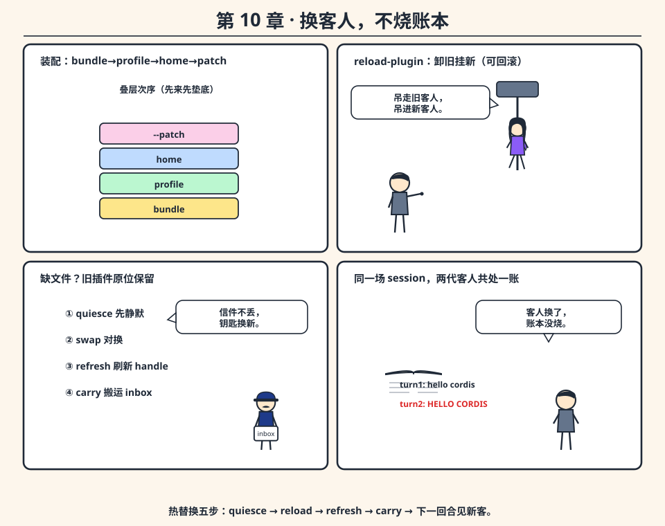

最后一章把所有零件装回一台机器，并回答收官之问：**客人换了，账本怎么活下来？**

## 装配：给同一台机器起两次名字

harness-spine 的答案是装配。两条路，同一批插件：

- **代码路**：`boot-spine` 按固定次序挂根插件（host → session → approval → llm → agents），再 `create-agent-handle "default"`；
- **YAML 路**：`cordis.yml` 列出同一批条目，`boot-spine-from-config` 拼装挂载。

实验让两种启动方式各跑一句 echo，都回答 `"yaml-parity"`。**装配不是第二条脊柱，而是给第一条起名的第二种办法。**

## 叠层：四个来源的先后

补丁从四层叠下来：**bundle → profile → home（`HARNESS_HOME` 的 `cordis.patch.reb`，或仓库根的）→ CLI `--patch`**。`profiles/minimal` 是根 YAML 的等价物；`profiles/full` 顺手给 session 配上 `store-dir`、给 llm 配上 script 适配器。你不必背下补丁语言——架构文档里的表是规格，`r3 -s boot-yaml.reb --profile minimal --dump-config` 是打印机。

## 热替换：同像热替换的仪式

`reload-spine-plugin` 五步换人，账本不动：

1. **静默**：对每个活着的智能体 `quiesce-agent`（回合开着就先 `cancel-turn`——用第 9 章的诚实协议收尾）；
2. **对换**：内核 `reload-plugin` 卸旧挂新（失败则回滚——失败的热替换留下的还是上一个插件，**缺文件不会装到一半**）;
3. **刷新**：`refresh-agent-refs` 把每个 handle 上的 `tools`/`driver` 重新指到新服务——因为依赖 `llm` 的 isolate Fiber 可能已被重建；
4. **搬运**：`carry-inbox` 把旧 driver 里没消费的信件搬进新 driver；
5. **回执**：同一场 session 的下一回合，echo 变成了 `"HELLO CORDIS"`——**客人换了，账本上上一回合的小写原封不动**。

> **你以为**：换适配器 = 重新赋值一个变量。
> **其实**：变量赋值换不掉 Fiber 换代之前被攥在手里的旧服务对象。所以才有仪式：静默、对换、刷新、搬运——**任何把服务对象一直攥过对换的东西都会出错，handle 被刷新正是为了这个。**

## 收官

现在整条脊柱都在你手里了：一扇门，一本账，几道闸，一次只问一声的许可，一位客人，一位每步重读的账房先生，私人房间，一份停下的协议，一套能换客人却不烧账本的装配。

接下来去哪？

- 想**亲手搭一遍**这台机器 → [《从零构建 harness-spine》](../build-harness-spine-from-scratch/BUILD_HARNESS_SPINE_FROM_SCRATCH.md)；
- 想逐行走源码 → 《harness-spine 是怎样工作的》；
- 想先吃透内核动词（waterfall / isolate / thenable / reload）→ 《Cordis 的 Rebol 移植是怎样工作的》。

## 动一动

```bash
cd ../../how-harness-spine-works/ch10-assemble-reload/code
bash run.sh
```

对答案：`CODE-ECHO / YAML-ECHO: yaml-parity`、`HIST` 四行（小写与大写共存一本账）、`ROLLBACK` 显示 `[LoaderError]` 且 `STILL-UPPER: STILL ALIVE`（回滚成功）。「试一试」第 3 条让你打印 `same? spine/llm spine/default-agent/driver/llm`——`true` 说明刷新真的发生了。

## 脑力充电站

1. 为什么热替换前要先静默所有智能体？
2. 热替换后，谁可能还攥着旧服务对象？

<details><summary>答案</summary>

1. 为了让每个打开的回合都经过第 9 章的诚实收尾（cancelled tool-result、turn-end），而不是在对换瞬间被腰斩——账本不允许「换成一半」的形状。
2. 任何在对换**之前**把 `spine/llm` 之类的服务拷进本地变量的人。handle 会被 `refresh-agent-refs` 刷新，你手里的临时绑定不会——这是缓存对象的代价。
</details>

## 速记卡

- 装配两条路：`boot-spine` / `cordis.yml`，`--dump-config` 验证等价。
- 叠层次序：bundle → profile → home → `--patch`。
- 热替换五步：quiesce → reload（可回滚）→ refresh handles → carry inbox → 下一回合见新客。

---

## 结业典礼

十 章 通关。回头看你学会的不是「某个框架的用法」，而是一组可以搬走的**判断题**：

| 下次有人说…… | 你可以问…… |
|---|---|
| 「存个 messages 数组就行」 | 取消后半截流谁来记？fork 后两份历史怎么不撞车？ |
| 「工具就是个函数」 | 被拒绝的调用有没有广播？测试替身插在哪一层？ |
| 「审批加个布尔」 | 问题死了，答案在哪？两个代码库默认值打架怎么办？ |
| 「模型说了算」 | 它拿什么执行？取消了它知道吗？ |
| 「杀进程就停了」 | session 里那只鬼魂谁清理？ |

每一条的答案都不在 slogan 里，在**账本的结构**里。欢迎带着这本速记卡，去读源码、去写你自己的 harness。

`LAB-OK`
